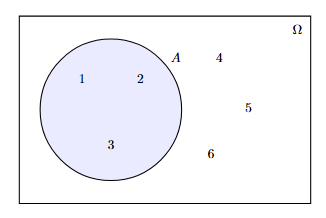
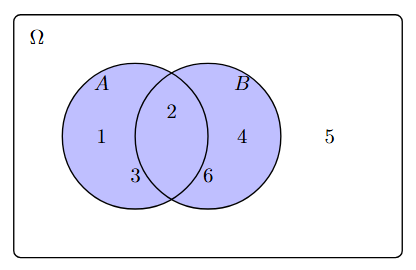

# **Set Theory**

_Last Edited: 21/10/2026_

### Sets, Sets, Sets

In the last section, we introduced the sample space $\Omega$ as a set of elementary outcomes $\omega_j$. Events were then subsets of the sample space. Now we consider 
relations between sets. This will allow us to chain events together using `AND` and `OR`. To do this, we must consider **set theory**. Thoughout these these sections, we will use Venn diagrams which are a simple way to visualise sets. As our first example, we will consider rolling a six-sided die where $\Omega = [1, 2, 3, 4, 5, 6]$. Let $A$ be the event of rolling a number below 4. We draw our diagram as follows,

The shaded region represents our set $A = [1, 2, 3]$. Everything outside of the set $A$ is called its compliment $A^C = [4, 5, 6]$. It is clear that $A \subset \Omega$ from the diagram. 

### Basic Relational Operators

Using set theory, we may say that $A$ and $B$ is the union $A \cup B$. For our purposes, a union between two sets that represent the events A and B is a set of mutually exclusive elementary outcomes. Going back to rolling the die, say that $B$ is event that an even number is rolled. $A = [1, 2, 3]$ and $B = [2, 4, 6]$ so $A \cup B = [1, 2, 3, 4, 6]$. Given that $A \cup B$ itself is a set, we can consider its complement $(A \cup B)^C = [5]$. The union between the union of all events and its compliment must exhaust all possible outcomes and must form the sample space: $A \cup B \cup (A \cup B)^C = \Omega$

### De Morgan's Laws

### References

De Morgan's Laws (in a probability context). JBStatistics (2018). URL: https://www.youtube.com/watch?v=LBGbwQDhceg.